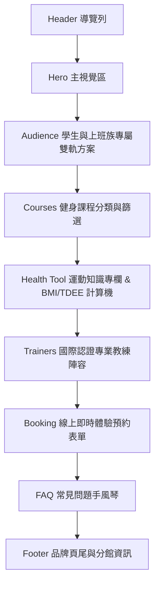

# Fit Life 健身生活網站 ｜ 完整逆向網頁規格說明書 (Reverse Engineering Specification)

> **來源檔案**：`WebPage_11515232/outline/index.html`  
> **關聯規格**：`WebSpec_11515232/specs/outline.md`  
> **文件用途**：針對已實作之「Fit Life 健身生活」現代活力響應式單頁網站進行完整逆向工程拆解，詳細規範品牌定位、UI/UX 視覺系統、資訊架構、互動邏輯與技術細節，作為後續維護、規格微調與重新生成之精確準則。

---

## 1. 專案概述與品牌定位

| 規格項目 | 規格細節說明 |
| :--- | :--- |
| **品牌名稱** | **Fit Life 健身生活**（英文：Fit Life Fitness） |
| **網站類型** | 現代專業運動健身服務與品牌形象單頁式官方網站 (One-Page Responsive Web App) |
| **網站用途** | 推廣健康生活與運動健身，提供科學化課程介紹、健康知識宣導、線上熱量試算與體驗預約 |
| **核心目標受眾** | **想要運動健身的學生與上班族**<br>• 🎓 **學生族群**：著重高 CP 值、免綁約彈性、課堂空堂進場、期中末壓力宣洩。<br>• 💼 **上班族群**：著重下班高效 45 分鐘燃脂、久坐肩頸腰背修復、星級淋浴與更衣設備。 |
| **品牌風格語氣** | **活力 (Energetic)**、**專業 (Professional)**、**現代 (Modern)**<br>文案兼具鼓舞人心的動能與科學化嚴謹度，以「喚醒能量、科學體態、極致自律、打破久坐」為核心語言。 |
| **核心品牌標語** | 「喚醒身體能量，鍛鍊精彩人生 (Awaken Your Energy, Forge Your Fit Life)」 |
| **交付形式** | 單一獨立 `index.html` 檔案，所有 CSS 樣式及 JavaScript 互動均原生內嵌，不依賴後端與外部打包工具。 |
不使用 CSS 插畫，使用既有圖片
**右欄圖片**

- 檔案位置
- `images\hero.png
- 使用 `` 元素顯示
- 圖片寬度：400px
- 圖片高度：300px

## 2. 技術邊界與基礎環境規範

- **HTML 標準**：語義化 HTML5（`<header>`, `<nav>`, `<section>`, `<article>`, `<form>`, `<footer>`），編碼統一為 `UTF-8`，語系指定 `zh-Hant`。
- **排版與樣式**：純原生 CSS3，採用 Flexbox 與 CSS Grid 混合排版，全站變數化 (`:root` CSS Custom Properties) 管理設計 Token。
- **互動腳本**：純原生 JavaScript (Vanilla ES6+)，無 jQuery 或前端框架依賴，頁面生命週期內即載即用。
- **圖標系統**：全站均使用內嵌向量 SVG（Inline SVG），具備高解析度縮放不失真、載入即顯且零外部 CDN 依賴中斷風險。
- **字型資源**：
  - 英數/主要數字/動態標題：`Outfit` (Google Fonts, weights: 400, 600, 700, 800, 900)
  - 中文內文/副標題：`Noto Sans TC` (Google Fonts, weights: 300, 400, 500, 700)
- **響應式標準 (RWD)**：
  - **桌面版 (Desktop)**：`>= 992px`（完整多欄雙側網格、固定懸浮工具欄）
  - **平板版 (Tablet)**：`768px ~ 991px`（雙欄折疊為單欄、彈性縮減邊距）
  - **行動版 (Mobile)**：`< 768px`（抽屜式漢堡選單、單欄垂直堆疊、全寬按鈕）

---

## 3. 視覺系統與設計 Token (Design Tokens)

### 3.1 色彩系統 (嚴格遵循：黑色、橘色、白色三主色)

```css
:root {
  /* 背景與表面層次色 (黑色系) */
  --bg-black:        #0c0e12;  /* 極致深黑底色，突顯運動沉浸感 */
  --bg-surface:      #141720;  /* 次級區塊交替背景底色 */
  --bg-card:         #1a1e29;  /* 內容卡片背景色 */
  --bg-card-hover:   #222736;  /* 卡片懸停聚焦加深色 */
  --bg-input:        #11141c;  /* 表單輸入框深凹陷底色 */

  /* 品牌能量重點色 (橘色系) */
  --brand-orange:       #ff5722;  /* 核心活力能量橘 */
  --brand-orange-light: #ff784e;  /* 明亮橘紅 (Hover/高光標籤) */
  --brand-orange-dark:  #e64a19;  /* 深色按鈕漸層深橘 */
  --brand-orange-glow:  rgba(255, 87, 34, 0.3); /* 霓虹光暈反射色 */
  --gradient-orange:    linear-gradient(135deg, #ff5722 0%, #ff8f00 100%);

  /* 文字與對比色 (純白與灰階系) */
  --text-white:    #ffffff;  /* 一級標題與純白醒目標籤 */
  --text-gray-100: #f1f5f9;  /* 主要內文清晰閱讀色 */
  --text-gray-300: #cbd5e1;  /* 次要文字與卡片副標 */
  --text-gray-400: #94a3b8;  /* 說明文字與元數據 */
  --text-gray-500: #64748b;  /* 輔助標籤與頁尾附註 */

  /* 邊框與光影效果 */
  --border-subtle: #272d3e;  /* 深色微妙線條邊框 */
  --border-accent: rgba(255, 87, 34, 0.45); /* 橘色強調外框線 */
}
```

### 3.2 圓角與陰影規範

| Token 名稱 | 數值 | 應用場景 |
| :--- | :--- | :--- |
| `--radius-sm` | `8px` | 輸入框、標籤膠囊 (Pills)、次級小徽章 |
| `--radius-md` | `14px` | 文章卡片、資訊預覽框、手風琴組件 |
| `--radius-lg` | `20px` | 主區塊卡片、預約容器、教練照片容器 |
| `--radius-full` | `9999px` | 圓形按鈕、分類篩選標籤 (Pills) |
| `--shadow-card` | `0 10px 30px rgba(0, 0, 0, 0.45)` | 卡片默認立體浮雕陰影 |
| `--shadow-glow` | `0 0 25px rgba(255, 87, 34, 0.35)` | 活力橘按鈕與焦點光暈效果 |

---

## 4. 網站資訊架構與各區塊規格詳解



### 4.1 頁首導覽列 (Header & Navigation)
- **結構**：
  - 吸頂式固定懸浮導覽列 (`position: sticky; top: 0; z-index: 1000`)
  - 半透明磨砂玻璃背板 (`background: rgba(12, 14, 18, 0.88); backdrop-filter: blur(14px);`)
- **Logo 標誌**：
  - 左側包含 40x40px 漸層圓角方塊，內置向量啞鈴圖標
  - 雙行字體排版：上方大字 `Fit Life`（Outfit 800），下方小字 `健身生活`（字母間距 0.12em）
- **導覽錨點選單**：
  1. 品牌首頁 (`#hero`)
  2. 專屬方案 (`#audience`)
  3. 健身課程 (`#courses`)
  4. 運動資訊與計算 (`#health-tool`)
  5. 專業教練 (`#trainers`)
  6. 常見問題 (`#faq`)
- **操作元件**：
  - 桌面版右側配置「立即預約體驗」CTA 按鈕 (`btn-primary btn-sm`)
  - 行動版配置 `<button class="nav-toggle">` 漢堡切換按鈕，螢幕寬度小於 768px 時彈性折疊。

---

### 4.2 主視覺區 (Hero Section)
- **版面**：非對稱雙欄網格 (`1.15fr : 0.85fr`)，背景為橘色能量微光放射漸層。
- **左側文案與引導區**：
  - 膠囊標籤：`⚡ 現代專業體適能中心`
  - 主標題：`喚醒身體能量 鍛鍊 Fit Life 精彩人生`（其中 `Fit Life` 採用橘黃漸層剪裁文字效果）
  - 描述副標：清楚標註「專為學生與上班族量身打造的運動空間」
  - 雙按鈕組合：
    - 主 CTA：`免費預約體態評估`（指向 `#booking`，帶箭頭圖標與橘光投影）
    - 次按鈕：`探索熱門課程`（指向 `#courses`，深色半透明邊框）
  - 成果指標量化看板（3 欄式數據）：
    - `12,000+` 累計蛻變學員
    - `98.6%` 課程滿意好評
    - `25+` 國際認證專業教練
- **右側互動式預覽卡片 (Hero Visual Card)**：
  - 頂部狀態燈：動態脈動呼吸綠點（`pulse-dot`），顯示「自由訓練時段開放中 / 尖峰客流實時監控」
  - 3 大快覽項目：
    1. 上班族下班高效率 45 分鐘燃脂（時鐘圖示）
    2. 學生極限體能爆發班（學士帽圖示）
    3. 一對一科學化體態評估（體重計/人物圖示）
  - 右下懸浮評分勳章：`★ 學員真實評價 4.9 星好評認證`

---

### 4.3 雙軌專屬服務區 (Audience Track Section)
專門針對兩大目標客群進行對稱式卡片展示，突顯痛點解決能力：

#### 🎓 學生專區（活力學生養成計畫）
- **設計配色**：蔚藍亮光輔助色 (`#38bdf8`)，帶學士帽徽章。
- **三大專屬權益**：
  1. **憑學生證享 8 折優惠**：單堂扣點、月費彈性不綁約。
  2. **非尖峰自主訓練時段**：空堂隨時進場，專注自主訓練。
  3. **新手基礎力量指導**：初學者免擔心，專業巡場教練耐心引導。
- **互動行為**：點擊「預約學生體驗方案」會觸發 `selectAudience('學生方案')`，自動為預約表單選定身分並滾動至表單。

#### 💼 上班族專區（下班身心解壓與體態雕塑）
- **設計配色**：活力深橘色 (`#ff5722`)，帶公事包徽章。
- **三大專屬權益**：
  1. **45 分鐘極速燃脂專班**：下班後準時開練，高效率不拖延生活。
  2. **體態矯正與核心加強**：專業修復久坐帶來的骨盆前傾與圓肩駝背。
  3. **五星級淋浴更衣空間**：運動後清爽洗沐，輕鬆赴約或安心返家。
- **互動行為**：點擊「預約上班族體驗」會觸發 `selectAudience('上班族專案')`，自動帶入表單並平滑滾動。
**影片崁入**

<iframe width="1337" height="752" src="https://www.youtube.com/embed/ri7Zo4r8mLE" title="觀念建立｜新手必看！第一次上健身房必須要知道的事！#新手訓練教室" frameborder="0" allow="accelerometer; autoplay; clipboard-write; encrypted-media; gyroscope; picture-in-picture; web-share" referrerpolicy="strict-origin-when-cross-origin" allowfullscreen></iframe>左為影片崁入
- 使用 `<iframe>` 元素顯示
- Youtube編號：hMOYa4EBntI
- 寬度：560px
- 高度：315px

### 4.4 健身課程介紹與分類模組 (Courses Section)
提供分類切換過濾器，支援不同強度的課程需求：

#### 分類篩選標籤 (Category Filter)
- `全部課程 (all)`、`極速燃脂 (burn)`、`肌力增肌 (strength)`、`體態舒壓 (posture)`、`1對1私教 (private)`

#### 六大核心精選課程規格清單

| 課程名稱 | 分類分類碼 | 推薦對象標籤 | 時長 | 預估熱量 | 難度星級 | 核心特色重點 |
| :--- | :---: | :---: | :---: | :---: | :---: | :--- |
| **上班族肩頸修復與核心體態** | `posture` | 上班族首選 | 45 分鐘 | ~320 kcal | ★★☆☆☆ | 針對久坐低頭族，進行筋膜放鬆、核心穩定與深層背肌啟動。 |
| **HIIT 爆汗極限間歇訓練** | `burn` | 學生超人氣 | 50 分鐘 | ~650 kcal | ★★★★☆ | 戰繩、壺鈴與波比跳結合，啟動 24 小時 EPOC 後燃效應。 |
| **科學化漸進超負荷重量訓練** | `strength` | 全民適用 | 60 分鐘 | ~480 kcal | ★★★☆☆ | 深蹲、臥推、硬舉三大項骨骼排列教學，強化骨質與肌肥大。 |
| **皮拉提斯核心肌群雕塑** | `posture` | 精緻小班 | 55 分鐘 | ~300 kcal | ★★☆☆☆ | 呼吸與骨盆中立位控制，強化腹橫肌，打造修長緊實線條。 |
| **運動員專項體能與敏捷強化** | `strength` | 學生最愛 | 50 分鐘 | ~550 kcal | ★★★★☆ | 步法變向、垂直彈跳與核心動力鏈，專為校隊系隊運動員設計。 |
| **一對一私人教練客製專案** | `private` | VIP 尊爵客製 | 60 分鐘 | 客製高強度 | ★★★★★ | InBody 分析 + FMS 篩檢，每週飲食追蹤與客製化週期訓練菜單。 |

- **快速預約動作**：每張卡片底部均配置「預約此課程」按鈕，點擊觸發 `bookSpecificCourse(courseName)`，自動將預約表單的課程下拉選單設定為該課程名稱並跳轉。

---

### 4.5 運動資訊與互動體態計算工具 (Health Information & Tool)

#### 左側：互動式健康指標計算機 (Interactive Calculator)
使用者輸入生理數據，系統即時算出關鍵健康指數與運動菜單建議：
- **輸入參數**：
  1. 生理性別（男性 `male` / 女性 `female`）
  2. 年齡（預設 25 歲，範圍 15 ~ 80）
  3. 身高（預設 172 公分，範圍 120 ~ 230）
  4. 體重（預設 65 公斤，範圍 30 ~ 200）
  5. 日常活動程度（久坐 1.2、輕度 1.375、中度 1.55、高強度 1.725）
- **運算邏輯**：
  $$\text{BMI} = \frac{\text{體重 (kg)}}{(\text{身高 (m)})^2}$$
  $$\text{BMR}_{\text{male}} = 10 \times \text{體重} + 6.25 \times \text{身高} - 5 \times \text{年齡} + 5$$
  $$\text{BMR}_{\text{female}} = 10 \times \text{體重} + 6.25 \times \text{身高} - 5 \times \text{年齡} - 161$$
  $$\text{TDEE} = \text{BMR} \times \text{活動係數}$$
- **結果動態回饋**：
  - 顯示精確 BMI 數值與體位判定（體重過輕 / 健康標準 / 微過重 / 肥胖警訊）
  - 基礎代謝率 (BMR) 與每日維持熱量 (TDEE)
  - 由系統自動配對教練專業建議（如肌肥大增肌熱量盈餘、或減脂熱量赤字安排）。

#### 右側：精選健康專欄文章 (Articles List)
- 文章 1：《告別久坐烏龜頸！辦公室必學的 4 個深層舒展動作》（標籤：上班族健康專欄，閱讀時間 3 分鐘）
- 文章 2：《外食族高蛋白指南：便利商店與學校食堂的高效率增肌減脂菜單》（標籤：學生生活指南，閱讀時間 4 分鐘）
- 文章 3：《重訓迷思大破解：新手運動後隔天不酸痛等於沒效果嗎？》（標籤：運動科學技巧，閱讀時間 5 分鐘）
- 互動行為：點擊「閱讀全文 →」將開啟精美 Modal 彈窗呈現完整圖文解析。

---

### 4.6 國際認證專業教練陣容 (Trainers Section)
配置 4 位教練專屬檔案卡片，展示國際權威證照背景：

| 教練姓名 | 專長領域與職稱 | 教學資歷 | 國際專業證照 | 訓練座右銘 |
| :--- | :--- | :---: | :--- | :--- |
| **Marcus Chen** | 肌力體能 & 力量增肌總監 | 7 年 | NSCA-CSCS, ACE-CPT, 健力國家裁判 | 「訓練不是為了痛苦，而是為了在槓鈴下找到最真實、最強悍的自己。」 |
| **Elena Lin** | 皮拉提斯 & 上班族體態矯正 | 5 年 | Polestar Pilates, NASM-CES, 筋膜放鬆證照 | 「重塑身體的平衡與柔軟，讓良好體態成為你最優雅自信的名片。」 |
| **Leo Wang** | 極限燃脂 HIIT & 競技運動表現 | 6 年 | EXOS-XPS, ACE-CPT, CrossFit L1 | 「在每一次心跳加速中突破極限，你所流的每一滴汗水都算數！」 |
| **Sarah Wu** | 功能性訓練 & 運動營養指導 | 4 年 | NASM-CPT, Precision Nutrition, TRX-STC | 「三分練七分吃，聰明建立可持續的生活型態，健康減脂不挨餓。」 |

- **互動行為**：點擊「預約教練」按鈕會調用 `selectTrainer(trainerName)`，將表單偏好教練欄位選中並平滑導引至預約區。

---

### 4.7 課程預約系統 (Booking System)
- **表單欄位規範**：
  1. `bookName`：真實姓名（必填 `required`）
  2. `bookPhone`：行動電話（必填 `required`）
  3. `bookEmail`：電子郵件（必填 `type="email" required`）
  4. `bookIdentity`：身分別（學生方案 / 上班族專案 / 一般民眾）
  5. `bookCourse`：預約課程（包含 6 門精選課程）
  6. `bookTrainer`：偏好教練（系統推薦或指定 Marcus、Elena、Leo、Sarah）
  7. `bookTimeSlot`：方便時段（晨間 07:00-09:30、午後 12:00-15:00、下班黃金時段 18:30-21:30、週末專班）
  8. `bookNotes`：個人運動目標或特殊需求（Textarea）
- **送出反饋流程**：
  1. 阻止默認表單跳轉 (`event.preventDefault()`)
  2. 提取輸入資訊，格式化注入確認彈窗組件 (`bookingSuccessModal`)
  3. 彈出成功 Modal 並重設表單清空輸入
  4. 承諾「24 小時內專人聯繫並附贈 InBody 體適能檢測」。

---

### 4.8 常見問題 (FAQ Accordion)
手風琴折疊問答，預設展開第 1 題：
- **Q1**：我完全沒有運動基礎，可以直接報名上課嗎？（解答分級退階教學原則）
- **Q2**：學生方案需要出示什麼證明？有限定學校嗎？（解答學生證認證與 8 折優惠規範）
- **Q3**：上班族下班尖峰時段，場館會不會人擠人、排不到器材？（解答智慧人流預約控管系統）
- **Q4**：初次預約需要準備什麼裝備或服裝？（解答運動服裝、室內鞋、水壺與毛巾須知）

---

### 4.9 品牌頁尾 (Footer)
- 品牌使命宣告與三主色代碼註解（黑色 `#0C0E12`、橘色 `#FF5722`、白色 `#FFFFFF`）
- 快速導覽連結清單
- 三大實體據點資訊：
  - 📍 **市中心旗艦館**（捷運站步行 2 分鐘）
  - 📍 **科技園區館**（內科/南軟上班族首選）
  - 📍 **大學校園館**（大專院校特約基地）
- 營運時間：週一至週五 06:30 - 23:30；週六與週日 07:30 - 22:30
- 客服免付費專線：0800-888-FIT
- 版權聲明：`© 2026 Fit Life 健身生活 (Fit Life Fitness Co., Ltd.) 版權所有。`

---

## 5. JavaScript 函式與事件映射表

| 函式名稱 | 觸發來源 / 事件 | 運作邏輯說明 |
| :--- | :--- | :--- |
| `navToggle.addEventListener('click')` | 行動端漢堡按鈕點擊 | 切換選單的 `.open` class，展開或收合行動抽屜導覽。 |
| `navMenu.querySelectorAll('a').click` | 行動選單項目點擊 | 點擊任意錨點後自動關閉選單，提供良好的單頁捲動體驗。 |
| `filterButtons.forEach.click` | 課程分類標籤點擊 | 比對卡片上的 `data-category` 屬性，執行 `display: flex / none` 動態過濾。 |
| `selectAudience(audienceType)` | 學生/上班族專區 CTA 點擊 | 自動填入表單 `bookIdentity` 欄位，並導航至預約區。 |
| `bookSpecificCourse(courseName)` | 課程卡片「預約此課程」點擊 | 自動填入表單 `bookCourse` 欄位，並透過 `scrollIntoView` 滑動至預約區。 |
| `selectTrainer(trainerName)` | 教練卡片「預約教練」點擊 | 自動填入表單 `bookTrainer` 欄位，並引導至預約區。 |
| `calculateHealthMetrics(event)` | 健康計算機表單 Submit | 驗證數值，計算 BMI、BMR、TDEE，判定體位狀態並給予個人化訓練建議。 |
| `handleBookingSubmit(event)` | 預約體驗表單 Submit | 阻止頁面跳轉，收集表單值動態呈現於 `bookingSuccessModal` 彈窗並重設表單。 |
| `openArticleModal(title, content)` | 運動專欄「閱讀全文」點擊 | 將文章標題與完整內容注入 Modal 容器並加上 `.active` 顯示。 |
| `closeModal(modalId)` | 彈窗關閉按鈕 / 遮罩點擊 | 移除目標彈窗的 `.active` class，恢復背景可操作狀態。 |
| `toggleFaq(headerElement)` | FAQ 標題欄位點擊 | 採用單一展開機制：收合其他項目，展開當前選取之問答內容。 |

---

## 6. 驗證與驗收檢查清單 (Acceptance Checklist)

- [x] **色彩嚴格遵循**：全站以黑色（`#0c0e12`, `#141720`）、橘色（`#ff5722`）、白色（`#ffffff`）為唯一色彩基調。
- [x] **品牌名稱完全一致**：網頁標題、Logo、Hero 標語均一致為「Fit Life 健身生活」。
- [x] **目標受眾精準命中**：同時兼顧學生（8折優惠、免綁約、彈性課表）與上班族（45分鐘燃脂、肩頸修復、淋浴設施）。
- [x] **四大核心功能完整具備**：
  - [x] 健身課程介紹（支援 5 種分類篩選、時長、消耗與難度星級）
  - [x] 運動資訊宣導（3篇健康文章 + 互動式 BMI/TDEE 計算機）
  - [x] 專業教練介紹（4位國際認證專業教練團隊、證照與座右銘）
  - [x] 線上即時預約（完整表單驗證、雙向資料綁定與成功反饋彈窗）
- [x] **純靜態獨立運作**：無外部打包工具依賴，圖片以純 SVG/CSS 完美繪製，任何現代瀏覽器均可直接離線或本機預覽。
